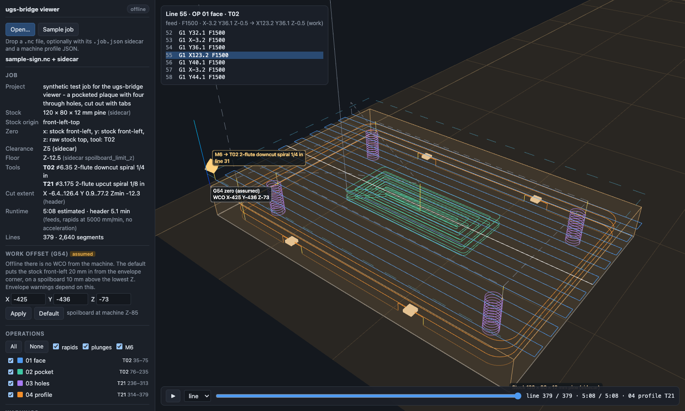

# ugs-bridge viewer (V1, offline)

A Three.js toolpath viewer for G-code jobs (SPEC §6, PLAN package D). It's a static web app:
plain ES modules plus an import map, with no build step. Three.js is vendored in `vendor/`.
The plugin will later serve this folder as-is at `/view/`.



## Open it

ES modules don't load from `file://`, so serve the folder over HTTP. Serve `bridge/` (not only
`bridge/viewer/`) so the machine profile and the public sample are reachable:

```sh
cd bridge && python3 -m http.server --bind 127.0.0.1 0   # prints the port
# open http://127.0.0.1:<port>/viewer/
```

Then drop a `.nc` file on the page or use **Open…**. Add the `<program>.job.json` sidecar (and,
if you like, a machine profile JSON) in the same selection. The **Sample job** button loads
`bridge/testdata-public/sample-sign.nc`.

URL parameters, for links and headless screenshots:
`?file=<url>&sidecar=<url>&profile=<url>&view=top|front|iso|machine&line=<n>&wco=x,y,z&section=<workZ>`.
With `file=` only, the viewer also tries `<program>.job.json` next to it.

## Features

| | Status |
|---|---|
| Open by drag and drop or the file picker (`.nc` + optional `.job.json` + optional profile) | done |
| Machine envelope, homing corner, spoilboard, BitSetter, tool-change park (from the profile) | done |
| Work-zero (G54) axes. The offset is an editable input, labeled *assumed* | done |
| Stock box from the sidecar or the `(STOCK: …)` header | done |
| Toolpath colored by operation; rapids dashed; plunges in yellow | done |
| Tool-change points with tool id and name (`M6 → T21 …`, line number) | done |
| Clearance plane (dashed, from `(CLEARANCE: …)` or the sidecar) | done |
| Timeline scrubber by line or by estimated time, play, ←/→ to step (Shift: ×100) | done |
| Current tool shown at the scrub position (cylinder of the tool's diameter) | done |
| Legend: show or hide each operation (name, tool, line range); click to scrub to its end | done |
| Section plane at Z (clips the toolpath and the stock) | done |
| Top and front (orthographic), iso and machine (perspective) views | done |
| Hover or click a segment: line number, op, tool, feed, from→to, ±3 lines of G-code | done |
| PNG snapshot, glTF (`.glb`) export | done |
| Warnings in red: cuts below the floor, moves outside the envelope (clickable list) | done |
| Fixtures (sidecar `fixtures`) drawn as boxes; tabs (sidecar `tabs`) as markers | drawn, not checked |
| Fixture-crossing warnings, material removal, live tool, probes, resume-path overlay | V2 / J4 |

**Floor** for the "below" warning: sidecar `spoilboard_limit_z`, else a header floor
(`through cut Z…` in `(STOCK: …)`, or `(FLOOR: Z…)`), else the stock bottom.

**Work offset.** Offline there's no WCO from the machine. The default puts the stock's
front-left corner 20 mm in from the envelope's front-left corner, with the stock bottom on an
assumed spoilboard 10 mm above the lowest Z. Envelope warnings and the spoilboard position depend
on it, and the panel says so. `G53` moves are converted with this offset (the program is
re-parsed when it changes).

**Time estimate.** Path length at the programmed feed, rapids at `(Rapids: N/min)` from the
header or 5000 mm/min, plus `G4` dwells. There's no acceleration model. dr_ryan comes out at
61.5 min against the post's 62.0 min.

## Code layout

```
index.html, styles.css      page, import map
src/main.js                 entry: profile lookup, URL parameters, window.ugsViewer
src/gcode/   (pure: no DOM, no Three.js; runs in Node)
  parser.js                 GRBL interpreter → flat segment table (typed arrays) in work coords
  arcs.js                   G2/G3 centers (I/J/K, R), chord-tolerance tessellation, helix, planes
  header.js                 post-processor header and marker parser
  job.js                    job model: sidecar > header > toolpath; ops, stock, floor, warnings
src/scene/                  Three.js
  viewer.js                 renderer, cameras, controls, views, section, picking, PNG/glTF
  toolpath.js               merged LineSegments per (operation × cut|plunge|rapid), scrub, pick
  machine.js                envelope, spoilboard, BitSetter, park
  labels.js                 constant-pixel-size sprite labels
src/data/
  sources.js                OfflineFileSource, UrlSource, LiveSource (stub), sidecar check
  profile.js                profile normalize, built-in fallback, default work offset
src/ui/app.js               panel, legend, scrubber, hover, export
test/*.test.js              node --test
vendor/three-0.170.0/       pinned Three.js (see vendor/README.md)
```

**Live mode later (V2, package E).** The viewer talks to a `JobSource` (`src/data/sources.js`).
`LiveSource` already reads the `#vt=<token>` hash and does the GET calls with
`Authorization: Bearer v.<token>`. The plan for it:

- Subscribe to `WS /events`.
- Move `viewer.toolpath.toolMarker` to the reported position (WPos = MPos − WCO from `/status`).
- Set the work offset from the real WCO instead of the assumed one: `App.setWorkOffset`.
- Draw a trail and probe markers as new layers under `viewer.work`.

The resume path (J4) can be a further layer that reuses `ToolpathLayer`'s merged-geometry
pattern.

## Tests

```sh
cd bridge/viewer && node --test test/*.test.js     # or: npm test
```

The tests cover:

- **Parser:** modal state, F on G0, unknown start positions, `G53` with the WCO, `G91`/`G90`,
  `G10`/`G92`/`G28` not drawn as moves, `M6`, plunge detection, the time estimate.
- **Arcs:** G2/G3 with I/J, full circles, chord tolerance, helices, R± arcs, G18/G19, G90.1, inch.
- **Headers:** header variants, op segmentation, warnings, the sidecar on the public sample.
- **Real files** in `bridge/testdata/nc/` (gitignored, skipped when absent). The dr_ryan file
  must give 9 ops, T02×4 then T21×5, header cut extent X 7.6..232.4 Y 7.6..87.4 Zmin −19.7, and
  the parsed path plus the cutter radius must reproduce that extent within 0.05 mm. Every file
  must parse, and each op's tool must match the last `M6`.

## Performance

These numbers are for dr_ryan (26 781 lines, 26 647 segments, 9 ops), measured in headless
Chrome with SwiftShader, which is software GL:

| Step | Time |
|---|---|
| Parse, job model and geometry build | about 55 ms |
| Frame | 0.5 ms (44 draw calls) |
| Scrub update (binary search + `setDrawRange`) | 0.03 ms |
| Hover raycast | about 1.1 ms |

The design choices behind these numbers:

- No per-segment objects: one merged `LineSegments` per operation and class.
- Render on demand.
- Arcs are tessellated to a 0.01 mm chord tolerance.

## Header patterns relied on

These are the post-processor comment patterns the viewer reads. Reconcile them with
`bridge/docs/post-headers.md`. Each is matched on the comment text inside `( … )`. Nested parens
are allowed. Where a field appears more than once, the first occurrence wins.

| Pattern | Example | Used for |
|---|---|---|
| `FILE: <name>` | `(FILE: dr_ryan_complete_T02_then_T21.nc)` | title |
| `PROJECT: <text>` | | info panel |
| `STOCK: … A x B x C …` | `(STOCK: at least 240 x 95 x 19.4 mm hard maple. …, through cut Z-19.7)` | stock size. `at least`, `>=` and `raw` mark it approximate |
| `STOCK: … A x B, raw t1-t2 thick` | `(STOCK: hard maple blank 298 x 184, raw 18.3-20.5 thick, in wood jig)` | thickness = t2 |
| `through cut Z<z>` inside STOCK | | floor for the "below" warning |
| `FLOOR: Z<z>` | `(FLOOR: Z-13.65 = 0.40mm INTO the spoilboard, by design)` (FreeCAD files) | floor |
| `ZERO …: <text>` / `WORK ZERO: <text>` | `(ZERO: X0 Y0 = stock FRONT-LEFT corner, Z0 = RAW STOCK TOP.)` | stock origin (`front`/`back`, `left`/`right`/`center`, `top`/`bottom`) when the text says *stock*. Otherwise the origin is *assumed*: on top of Z0 if every cut is above Z0 (jig-top zero), else front-left-top |
| `CLEARANCE: … Z+<z>` | `(CLEARANCE: every rapid/retract at Z+5 [work]. …)` | clearance plane |
| `UNITS: mm\|in` | `(UNITS: mm [G21] …)` | not used: G20/G21 in the code decide |
| `TOOL …: T<n> <desc>` | `(TOOL [FIRST]: T02 2-flute downcut spiral 1/4 in, Whiteside RD2100   feed 1778 / plunge 508 mm/min …)`, `(TOOL AFTER THE MID-FILE TOOL CHANGE: T21 …)`, `(TOOL: T21 …)` | tool table |
| `<n>. T<n>  <desc>` in a tools list | `(  1. T01  3-wing surfacing bit 1 in    Whiteside 6210   LOADS AT ~min 1 …)` plus indented continuation lines with `feed … / plunge …` | tool table |
| `INSTALL IN COLLET: T<n> <desc>`, `LOAD: T<n> <desc>`, `GEOM: dia <d> mm   flute <f> mm`, `BIT: <maker model>` | tool-change blocks | tool table, diameter |
| `   T<n>   <d> mm (…)  feed …` | FreeCAD header `(   T3    6.350 mm (0.2500 in)   feed  2032 mm/min   18000 RPM)` | tool table |
| `     tool T<n> <desc>, feed … / plunge …` | detail line under an op marker | tool table |
| `OPERATIONS:` list items `<n>. [T<n>] <name> - <desc>` or `<n>. [T<n>] ~min <m>  <name>` | `(  5. [T21] clear_hi - Clear what T02 could not reach …)` | op descriptions and tools for colon-style markers |
| **op marker, pipe style** `---- OP <nn> \| T<nn> \| <name> \| <desc> ----` | `(---- OP 05 \| T21 \| clear_hi \| Clear what … ----)` | operation start |
| **op marker, colon style** `---- OP <n>: <name> ----` | `(---- OP 3: lid recess ----)` | operation start. The tool is the planned op's tool, else the last `M6` |
| FreeCAD `Begin operation: <name>` / `Finish operation: <name>` | | operations. Those without motion (tool controllers, `Fixture`) are dropped. `TC_T03_6.35mm_…` gives a diameter |
| `CUT EXTENT …: X a..b  Y c..d  Zmin z` | `(CUT EXTENT incl cutter: X 7.6..232.4  Y 7.6..87.4  Zmin -19.700)` | info and tests |
| `EST RUNTIME: <m> min` | | info (compared with our estimate) |
| `Rapids: <rate>/min` | `(Rapids: 5000.0/min)` (Fabex) | rapid rate for the time estimate |

**Operation ranges.** An op runs from its marker line to the line before the next marker; the
last op runs to the end of the file. This is the convention used in the SPEC §6.3 sidecar
example, where `clear_hi` is `[47, 2083]`. So the tool-change block between two ops belongs to
the earlier op.

**No markers at all.** Ops are split at each `M6`, or the whole file is one op. A sidecar's
`operations` replace the header ops entirely.

## Open questions

1. Live mode needs the program text. `GET /file` returns only metadata, so package E should add
   `GET /file/content` or similar. Browsers also can't set `Authorization` on a WebSocket, so
   `/events` needs another token transport for the viewer, such as a query parameter or a
   subprotocol.
2. The profile has no spoilboard machine Z and no BitSetter top Z, so the viewer assumes them.
   Add `spoilboard_z_machine` (and the BitSetter height) to the profile schema?
3. Multi-file jobs on a jig (step20/30/50) zero on the jig, not the stock. The stock placement
   is a guess there; a sidecar `stock.origin`/offset would fix it.
4. Op range convention: should the tool-change block belong to the next op? The resume logic
   (J1) and the sidecar writer should agree.
